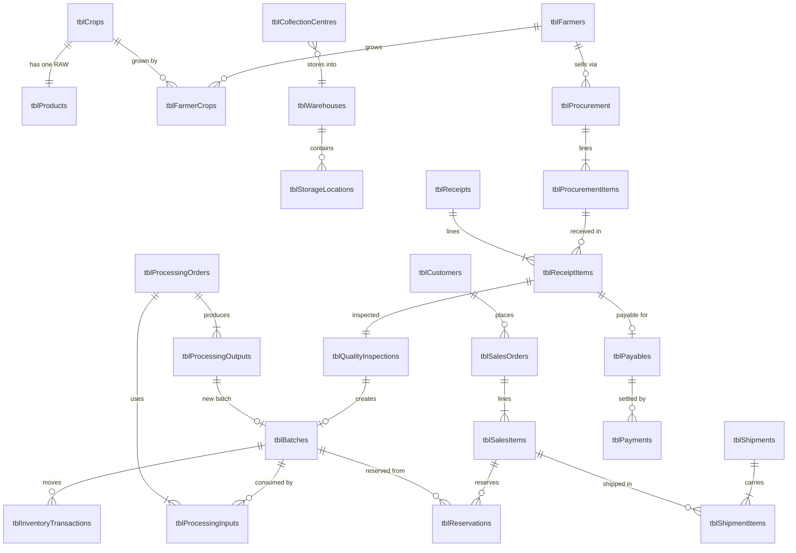

# Database Design — AgriChain 360

_Status: Draft for owner review · 2026-10-11_

The live database is one private Google Sheet. **Each table is one tab**: row 1 is the header and each
later row is one record. The field-by-field definitions are in `DATA_DICTIONARY.md`, and the rules are in
`BUSINESS_RULES.md`.

---

## 1. Conventions (apply to every table)

| Convention | Rule |
|---|---|
| Table names | `tbl` + plural PascalCase, e.g. `tblFarmers` |
| Column names | `snake_case`, never renamed once data exists |
| Primary key | First column, `<entity>_id`, a prefix plus 6 digits (e.g. `F000001`), issued by `tblSequences` under the lock. **Never a row number** |
| Foreign key | Same column name as the referenced key (e.g. `crop_id`) |
| Quantities | **kg**, number, up to 3 decimals, never negative unless the rule says so |
| Money | ₹ INR, number, rounded to 2 decimals at line level |
| Business dates | `YYYY-MM-DD` text, India time (IST) |
| Timestamps | ISO 8601 UTC text, e.g. `2026-10-11T08:23:45.389Z` |
| Codes / enums | UPPER_SNAKE text from a fixed list in code (e.g. `ACTIVE`) |
| Text cells | Stored as plain text. Text starting with `= + - @` is escaped (formula-injection protection) |
| Deleting | **Never.** Master data is deactivated (`status = INACTIVE`), and transactions are cancelled or reversed |

### Standard columns on every master table
`status` (ACTIVE / INACTIVE) · `created_at` · `created_by` · `updated_at` · `updated_by` · `row_version`

`row_version` starts at 1 and increases by 1 on every update. An update that sends an older version
is rejected with `STALE_RECORD`, so nobody silently overwrites someone else's change.

### ID prefixes
| Entity | Prefix | Example | Entity | Prefix | Example |
|---|---|---|---|---|---|
| Crop | C | C000001 | Procurement (PO) | PO | PO000001 |
| Product | PR | PR000001 | Procurement line | POL | POL000001 |
| Farmer | F | F000001 | Receipt (GRN) | GRN | GRN000001 |
| Farmer–crop | FC | FC000001 | Quality inspection | QC | QC000001 |
| Collection centre | CC | CC000001 | Batch / lot | LOT | LOT000001 |
| Warehouse | WH | WH000001 | Inventory transaction | IT | IT000001 |
| Storage location | SL | SL000001 | Processing order | PRO | PRO000001 |
| Customer | CU | CU000001 | Sales order | SO | SO000001 |
| Transporter | TR | TR000001 | Shipment | SHP | SHP000001 |
| Vehicle | VH | VH000001 | Payable / Payment | PAY / PMT | PAY000001 |
| User | U | U000001 | Wastage | WS | WS000001 |

---

## 2. All tables by phase

| Phase | Tables |
|---|---|
| 0 (system) | `tblSequences`, `tblUsers`, `tblAuditLog`, `tblRequestLog`* |
| 1 Master data | `tblUnits`, `tblCrops`, `tblProducts`, `tblFarmers`, `tblFarmerCrops`, `tblCollectionCentres`, `tblWarehouses`, `tblStorageLocations`, `tblCustomers`, `tblTransporters`, `tblVehicles` |
| 2 Procurement | `tblProcurement`, `tblProcurementItems`, `tblReceipts`, `tblReceiptItems` |
| 3 Quality | `tblQualityInspections`, `tblQualityParameters` |
| 4 Batches | `tblBatches` |
| 5 Inventory | `tblInventoryTransactions`, `tblReservations`, `tblStockCounts` |
| 6 Processing | `tblProcessingOrders`, `tblProcessingInputs`, `tblProcessingOutputs` |
| 7 Wastage | `tblWastage` |
| 8 Sales | `tblSalesOrders`, `tblSalesItems` |
| 9 Logistics | `tblShipments`, `tblShipmentItems` |
| 10 Payments | `tblPayables`, `tblPayments` |
| 11 Alerts | `tblAlerts`, `tblApprovals` |
| 12+ Analytics | `tblMarketPrices`, `tblDemand`, `tblForecasts` |

\* `tblRequestLog` stores `request_id` → result for every write, so duplicate protection works the same
way for all tables. It replaces the per-table `request_id` column used in the proof of concept.

**Roles are not a table.** Role names and the permission matrix live in backend code (`Config.gs`), so
nobody can grant themselves rights by editing a cell. `tblUsers` assigns each user one role.

---

## 3. Relationship decisions (resolving the ambiguous relationships)

| # | Question | Decision |
|---|---|---|
| R1 | Crop vs Product | **Crop** is what farmers grow (Wheat – Sharbati). **Product** is anything we stock or sell. Every crop gets exactly **one RAW product**, created automatically with the crop. Processing creates FINISHED and BYPRODUCT products (e.g. Wheat Flour, Bran). Inventory, batches and sales always use `product_id`. |
| R2 | Procurement header vs lines | A **PO header** (one farmer, one collection centre) has many **PO lines** (product, ordered kg, ₹ rate). |
| R3 | Ordering vs physical receipt | A **Receipt (GRN)** is separate. One PO line can be received in several receipts (partial deliveries). **Creating a PO never creates stock.** |
| R4 | Receipt vs quality | Each receipt line gets **one quality inspection**: received = accepted + rejected + held. |
| R5 | Batch vs inventory | A **batch** describes a lot (product, source, grade, dates, expiry). It holds **no quantity column**. One batch is created per inspected receipt line, so each farmer delivery stays traceable. |
| R6 | Inventory balance vs ledger | **The ledger (`tblInventoryTransactions`) is the only source of truth.** Balance = sum of ledger rows per batch × location × stock status. A balance view may be cached for speed, but it is always rebuildable and never edited directly. |
| R7 | Available / reserved / blocked | Each ledger row has `stock_status` AVAILABLE or BLOCKED. Moving stock between them takes two ledger rows that net to zero. **Reserved** stock is in `tblReservations`. Allocatable = AVAILABLE on hand − active reservations − expired stock. |
| R8 | Processing with many outputs | A processing order has many **inputs** (batches consumed) and many **outputs** (FINISHED, BYPRODUCT or LOSS lines). Each FINISHED or BYPRODUCT output creates a new batch linked to the order, so traceability continues downstream. |
| R9 | Sales order vs items | An **SO header** (one customer) has many **sales items** (product, kg, ₹ rate). Allocation reserves specific batches against an item. |
| R10 | Shipments and partial deliveries | An SO can have many **shipments**. Each shipment item names the sales item, batch, dispatched kg, delivered kg, shortage kg and damaged kg. |
| R11 | Users vs identities | A user is identified by their **verified Google email** (see D-003). There are no passwords. |
| R12 | Payable vs payment | A **payable** is created from an inspected receipt line: **accepted kg × PO rate**. Rejected and held kg are not payable until released. Many **payments** may settle one payable, and the total paid can never exceed the payable. |
| R13 | Collection centre vs warehouse | Stock always sits in a **warehouse**. Each collection centre is linked to the warehouse where its receipts are stored (that may be a small warehouse of type COLLECTION_POINT). |
| R14 | Wastage | Wastage is a record **plus** a WASTAGE ledger row. It is never a silent stock edit. |

---

## 4. Relationship diagram (core flow)

The traceability chain is: **Farmer → PO → Receipt line → Inspection → Batch → (Processing → new Batch)
→ Reservation → Shipment item → Customer.** Every arrow is a stored ID, so it can be followed in both
directions.

---

## 5. Environments
- **TEST**: the current `AgriChain360_DB_POC` spreadsheet. Synthetic sample data only.
- **PROD**: a separate spreadsheet and a separate Apps Script deployment, created before real use.
  It never contains sample data.
